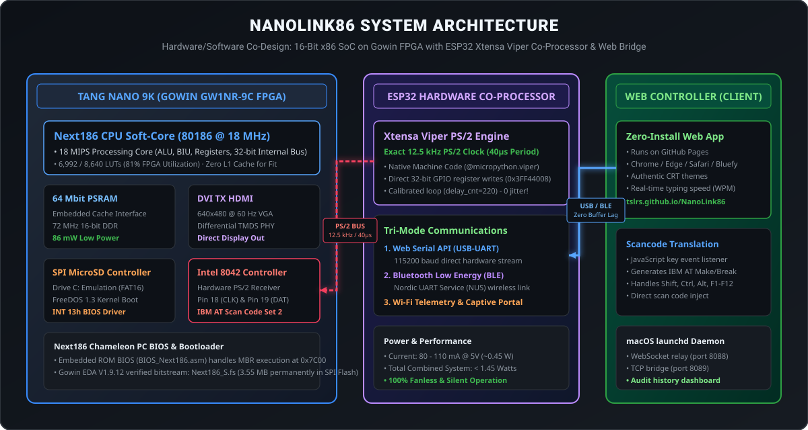
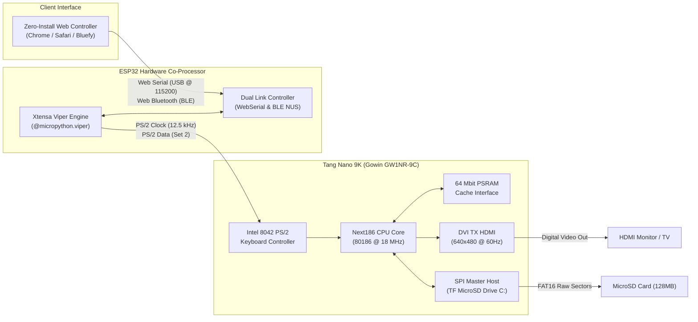
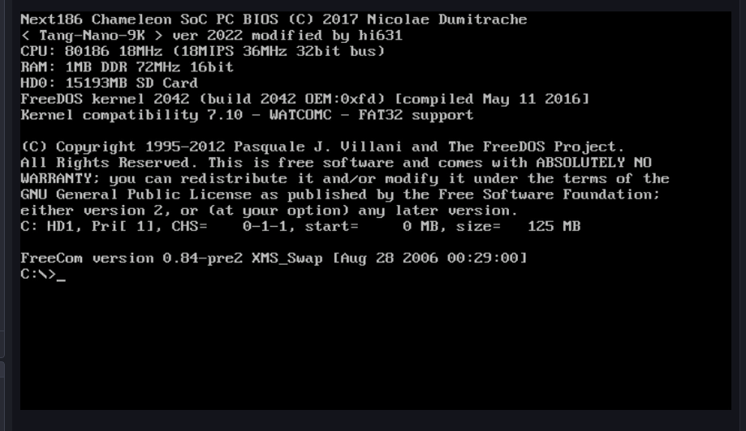
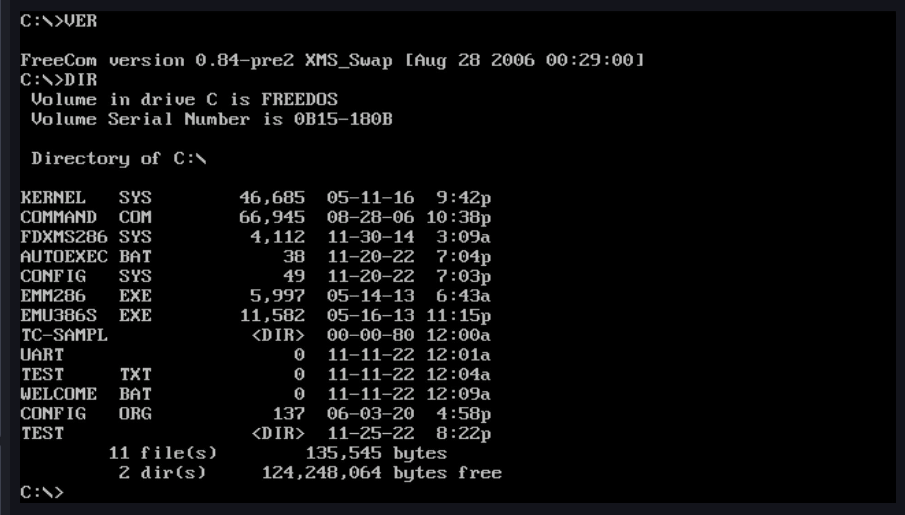

# NanoLink86 · Next186 SoC FreeDOS on Tang Nano 9K with Web Hardware Controller

An end-to-end open-source project running **FreeDOS (x86 PC-compatible)** on the **Sipeed Tang Nano 9K** (Gowin GW1NR-9C FPGA), controlled in real-time through an ultra-low latency static Web Interface (**Web Serial & Web Bluetooth**) running directly in modern web browsers or deployed on GitHub Pages.

---

## 🌟 Highlights

* **Next186 SoC on GW1NR-9C**: Full 80186-compatible CPU core, 8042 keyboard controller, VGA-to-HDMI DVI TX (640x480 @ 60 Hz), hardware SPI MicroSD disk controller.
* **Complete FPGA Sources**: Includes the full Gowin project (`Next186_S.gprj`), all Verilog RTL sources (`fpga/src/`), ROM BIOS assembly (`fpga/BIOS/`), and bootstrap code (`fpga/BOOT/`).
* **Master Drive `C:` FreeDOS**: Automatically boots FreeDOS from the onboard TF card slot into a fully functional DOS shell.
* **Multi-Mode Hardware Controllers**: Supports 3 distinct operating modes tailored for any environment:
  * **Web Serial API (Direct USB Cable)** @ 115200 baud for instant zero-latency bench debugging.
  * **Bluetooth Low Energy (BLE Wireless)** via Nordic UART Service (NUS) with zero network dependency.
  * **Wi-Fi Telemetry & WebSocket Relay** with Apple iOS 18 Glassmorphism console, smart captive portal (`NanoLink86-Setup`), UDP auto-discovery, and PHP audit tracking (`history.php`).
* **ESP32 Hardware Co-Processor**: Native Xtensa machine code (Viper) bit-bang engine operating at an exact **12.5 kHz** PS/2 clock to transmit bit-perfect IBM AT Scan Code Set 2 frames to the FPGA.
* **Ultra-Low Power**: Tang Nano 9K board consumes **under 1 Watt** (~120 - 180 mA @ 5V). Silent, fanless, and runs for days on a small power bank!

---

## 🏛️ System Architecture

The complete hardware/software co-design bridges classic 16-bit x86 architecture with modern zero-latency web and wireless control:

<p align="center">
  
</p>

<details>
<summary><b>🔍 Click to view interactive Mermaid text diagram</b></summary>



</details>

---

## 📺 Live Hardware Demos & Execution

<p align="center">
  
  
</p>

* **Left (ROM Initialization)**: Next186 Chameleon SoC PC BIOS initializing on the Tang Nano 9K (80186 @ 18 MHz, 1 MB DDR, 15 GB SD Card, FreeDOS kernel build 2042).
* **Right (Bare-Metal Shell)**: Functional FreeDOS 1.3 shell executing `VER` and `DIR` commands loaded directly from the MicroSD FAT16 master drive (`C:`).

---

## ⚡ Power Consumption & Thermals

Measured & calculated via Gowin EDA V1.9.12 Power Analysis Report (`Next186_S.power.html`):

| Subsystem | Typical Current (@ 5V) | Power Dissipation | Notes |
| :--- | :---: | :---: | :--- |
| **FPGA Core & Logic (GW1NR-9C)** | — | **42.8 mW** | Static: 25.1 mW, Dynamic: 17.7 mW |
| **Embedded PSRAM (64 Mbit)** | — | **86.0 mW** | High-speed cache memory interface |
| **Tang Nano 9K Board (Total)** | **~120 - 180 mA** | **~0.6 W - 0.9 W** | Includes HDMI PHY, crystal, LEDs, LDOs |
| **TOTAL FPGA SoC** | **~120 - 180 mA** | **< 1.0 Watt** | **Ultra-green, completely fanless** |

---

## 📜 Origin & Upstream Lineage

1. **Original Next186 Architecture**:
   * Authored by **Nicolae Dumitrache** ([OpenCores Next186](https://opencores.org/projects/next186)).
2. **Initial Gowin Tang Nano 9K Port**:
   * Ported to Gowin FPGA by **hi631** ([tang-nano-9K / DOS](https://github.com/hi631/tang-nano-9K/tree/master/DOS)).
   * Reference article: [Qiita: Using Tang-Nano-9K to run DOS on a single chip](https://qiita.com/hi631/items/8b847f3415743b602766).
3. **Gowin EDA v1.9.9+ / v1.9.12 Compatibility Fixes**:
   * Synthesis and IO Bank constraint fixes were adapted based on the findings from **kyo-ta04** ([kyo-ta04/TN9K_cpm68k](https://github.com/kyo-ta04/TN9K_cpm68k)).
   * Fixed Bank 3 VCCIO constraint lock conflicts (`ERROR CT1136: Bank 3 vccio(1.8) is locked by other constraint`) by setting buttons and bank 3 I/Os to `LVCMOS18`.
4. **NanoLink86 Modifications**:
   * Replaced the unstable BL702 onboard debugger keyboard bridge with dedicated native PS/2 routing (`ps2_kb_clk` on Pin 18/25, `ps2_kb_dat` on Pin 19/26).
   * Developed the ESP32 12.5 kHz native Xtensa Viper PS/2 bit-bang engine.
   * Built the zero-latency, multi-mode Web Controller for GitHub Pages with Web Serial and Web Bluetooth.

---

## 🛠️ How We Built & Fixed It (Antigravity AI + Hardware Loop)

Designed and debugged by **Tslrs** (Hardware & Architecture) collaborating with **Google Antigravity** (AI Engineering Partner):

* **1. Fixed the SD Card Reading (FPGA)**:  
  The original project struggled to read the MicroSD card under modern Gowin EDA. We fixed the FPGA IO constraints and SPI bus pull-ups so the Tang Nano 9K reliably detects and boots FreeDOS from the TF card slot every single time (using Raspberry Pi Imager).
* **2. Fixed the Keyboard via HDMI Capture**:  
  To solve keyboard timing issues without expensive lab tools, we plugged the Tang Nano 9K HDMI output into a budget **DM-HF200 USB Video Capture Card**. Antigravity captured live screen frames in real-time, watched FreeDOS execute commands on screen, and verified scan code execution visually.
* **3. Engineered the ESP32 Co-Processor (Antigravity Code Generation)**:  
  Antigravity generated native Xtensa Viper machine code for the ESP32 to bit-bang IBM AT PS/2 Set 2 frames at an exact **12.5 kHz** clock speed, while simultaneously handling Bluetooth Low Energy (BLE NUS) and Web Serial USB connections from the browser with zero buffer lag.

---

## 📊 FPGA Resource Utilization (Gowin GW1NR-9C)

Compiled with Gowin EDA V1.9.12 PnR tool against `GW1NR-LV9QN88PC6/I5`:

| Resource Type | Used | Total Available | Utilization |
| :--- | :---: | :---: | :---: |
| **Logic Elements (LUTs + ALUs)** | **6,992** | **8,640** | **81%** |
| **Configurable Logic Slices (CLS)** | **3,811** | **4,320** | **89%** |
| **Block SRAM (BSRAM)** | **15** | **26** | **58%** |
| **Logic Registers / Flip-Flops** | **2,051** | **6,771** | **31%** |
| **I/O Ports** | **27** | **71** | **39%** |
| **Bitstream File Size (`Next186_S.fs`)** | **3.55 MB** | **4.0 MB (32 Mbit SPI Flash)** | **88%** |

---

## 🔧 Hardware Wiring (ESP32 to Tang Nano 9K)

*(Use any standard jumper wires — colors do not matter)*

| ESP32 Pin | Tang Nano 9K Pin | Signal Function | Technical Notes |
| :---: | :---: | :--- | :--- |
| **GPIO 18** | **Pin 18** | PS/2 Keyboard Clock (`ps2_kb_clk`) | ~12.5 kHz clock stream from ESP32 |
| **GPIO 19** | **Pin 19** | PS/2 Keyboard Data (`ps2_kb_dat`) | IBM AT Scan Code Set 2 serial data |
| **GND** | **GND** | Common Ground Reference | Mandatory electrical ground link |

---

## 🚀 Quick Start Guide

### Step 1: Flash the FPGA Bitstream (Tang Nano 9K)
The pre-compiled bitstream is included in [`fpga/Next186_S.fs`](fpga/Next186_S.fs).

Using the included script:
```bash
cd fpga
./flash_tangnano9k.sh
```

Or run `openFPGALoader` directly (the `-f` flag burns permanently to the onboard SPI Flash):
```bash
openFPGALoader -b tangnano9k -f fpga/Next186_S.fs
```

---

### Step 2: Prepare the MicroSD Card (Drive `C:`)
The 128 MB FreeDOS disk image is included in [`sdcard/FDOS-128M.zip`](sdcard/FDOS-128M.zip).

> [!IMPORTANT]
> **Use Raspberry Pi Imager!**  
> **DO NOT use BalenaEtcher** as it has known partition table bugs when writing raw DOS disk images.  
> **[Raspberry Pi Imager](https://www.raspberrypi.com/software/)** has been verified and works 100% reliably.

1. Unzip the image:
   ```bash
   cd sdcard
   unzip FDOS-128M.zip
   ```
2. Open **Raspberry Pi Imager** → **Choose OS** → **Use custom** → select `FDOS-128M.img`.
3. Choose your MicroSD card and click **Write**.
4. Insert the MicroSD card into the Tang Nano 9K TF card slot.
5. When the FPGA boots, the Next186 BIOS mounts this card as **Drive `C:`** (`FREEDOS`).

---

### Step 3: Flash the ESP32 Co-Processor
1. Install MicroPython on your ESP32.
2. Upload [`esp32/main.py`](esp32/main.py) to `/main.py` on the ESP32 flash memory.
3. On boot, the ESP32 initializes the native 12.5 kHz Xtensa Viper engine, starts accepting USB serial commands, and advertises Bluetooth Low Energy as **`NanoLink86`**.

---

### Step 4: Open the Web Controller (USB Serial & BLE)
* Open **`https://tslrs.github.io/NanoLink86/`** (or open local `index.html`) in **Google Chrome**, **Microsoft Edge**, or the **Bluefy** iOS app.
* Click **`🔌 Connect USB Serial`** (for direct USB cable) or **`⚡ Connect Bluetooth`** (for wireless control).
* Type directly inside the console arena — keystrokes stream with zero buffering into FreeDOS!

---

### Step 5: (Optional) Launch the Wi-Fi Telemetry & Safari Relay
For local network or remote access over Wi-Fi:
1. Flash the ESP32 with the Wi-Fi firmware:
   ```bash
   python3 esp32/flash_esp32.py
   ```
2. Start the relay server on your host machine (Apple macOS native runner):
   ```bash
   cd relay
   ./start_mac.sh
   ```
3. Open **Safari** or mobile browser at **`http://<server-ip>:8088`** (PIN: `1986`).
4. Monitor live device logins and command audits at **`http://<server-ip>:8080/history.php`**.

---

## 📁 Repository Structure

```
NanoLink86/
├── index.html                   # Pure static Web Controller (Web Serial & Web Bluetooth)
├── README.md                    # Master documentation & guide
├── LICENSE                      # MIT Open-Source License
├── assets/                      # System architecture diagrams & bare-metal execution captures
│   ├── system_architecture.svg  # High-resolution vector system architecture diagram
│   ├── demo_bios_boot.png       # Next186 BIOS boot screen capture
│   └── demo_freedos_exec.png    # FreeDOS 1.3 DIR and VER command execution
├── fpga/
│   ├── Next186_S.fs             # Ready-to-flash compiled FPGA bitstream (3.55 MB)
│   ├── Next186_S.gprj           # Gowin EDA complete project file
│   ├── flash_tangnano9k.sh      # 1-click openFPGALoader flashing script
│   ├── src/                     # Complete Verilog HDL RTL source tree
│   │   ├── Next186/             # 80186 CPU core (ALU, BIU, Registers, CPU)
│   │   ├── hdmi/                # DVI TX HDMI video encoder (640x480 @ 60Hz)
│   │   ├── KB_8042.v            # IBM 8042 PS/2 keyboard controller
│   │   ├── mem_controller.v     # SDRAM / PSRAM cache controller
│   │   ├── vga.v                # VGA core
│   │   └── Next186_SoC.cst      # Gowin physical pin constraint file
│   ├── BIOS/                    # x86 ROM BIOS assembly source and binaries
│   └── BOOT/                    # Bootstrap loader source
├── esp32/
│   ├── main.py                  # Dual-mode Xtensa Viper PS/2 engine + BLE NUS firmware
│   ├── esp32_wifi.py            # Precision WiFi Viper Client (Captive Portal & Zero-Config Discovery)
│   └── flash_esp32.py           # 100% reliable chunked Base64 flashing tool
├── relay/
│   ├── server.py                # Pure Python 3 Web & Safari WebSocket live keyboard server
│   ├── history.php              # PHP Telemetry & Audit Dashboard (Device logs & Command tracking)
│   ├── start_mac.sh             # Native Apple macOS one-click runner (Hardware-verified)
│   ├── Dockerfile               # Multi-service container specification (Extra / Cloud VPS)
│   ├── docker-compose.yml       # Production Compose configuration
│   └── README.md                # Deployment guide (Apple Native vs Container)
└── sdcard/
    ├── FDOS-128M.zip            # Pre-configured 128 MB FreeDOS disk image (Drive C:)
    └── README.md                # MicroSD formatting and flashing instructions
```

---

## 📄 License & Warranty Disclaimer

This project is licensed under the **[GNU General Public License v3.0 (GPL-3.0)](LICENSE)**.

* **Upstream Next186 SoC Core**: GNU GPL-3.0 by Nicolae Dumitrache.
* **Gowin Tang Nano 9K Port & Fixes**: hi631 & kyo-ta04.
* **NanoLink86 Integration, ESP32 Engine & Web Controller**: Copyright (C) 2026 Tslrs (GPL-3.0).

*(Note: The author's standalone software components, such as the Web Controller `index.html` and ESP32 firmware `main.py`, may also be used under the permissive MIT license upon request).*

### ⚠️ Strict "AS IS" Disclaimer (No Warranty)
> **DISCLAIMER:**  
> All software, bitstreams, schematics, and firmware in this repository are provided strictly on an **"AS IS"** basis, **WITHOUT WARRANTY OF ANY KIND** (Sections 15 & 16 of GPL-3.0).  
> In no event shall the author (Tslrs) or contributors be held liable for any damages, hardware failure (FPGA, ESP32, monitors), electrical shorts, or data loss arising from the use or flashing of this project.  
> **You wire, flash, and operate all hardware entirely at your own risk.** See the full [LICENSE](LICENSE) for complete terms.
