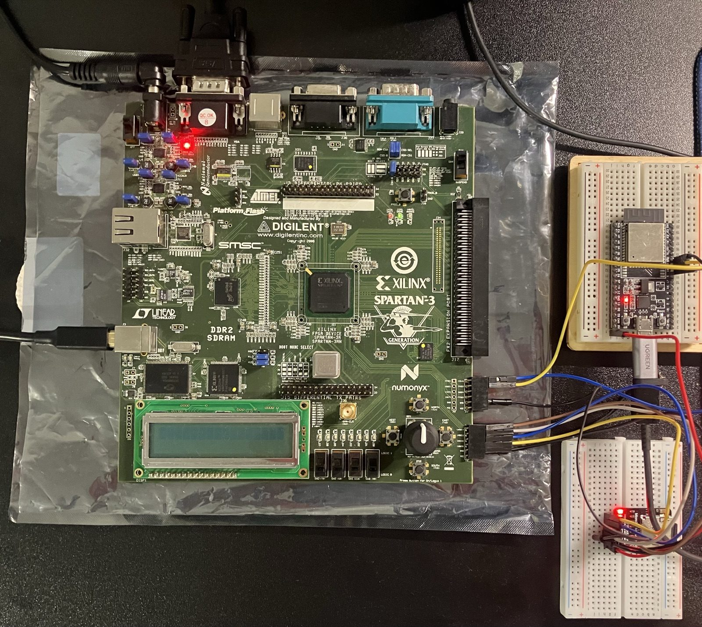
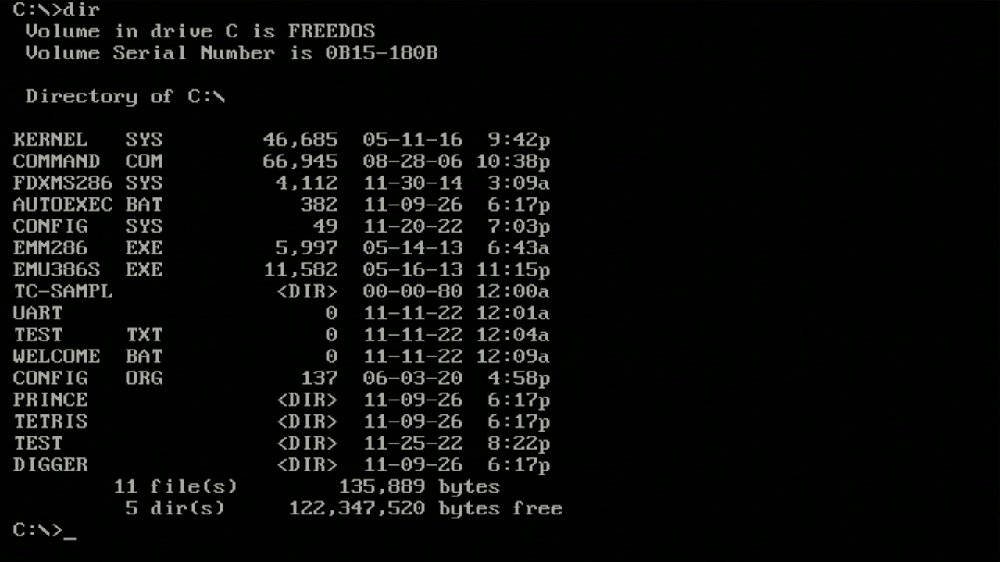
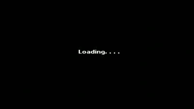
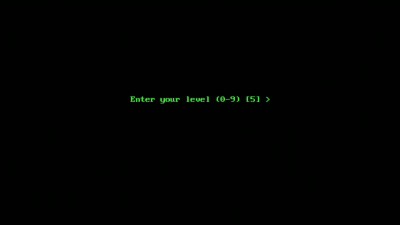

# Next186 SoC FreeDOS on Xilinx Spartan-3A Starter Kit

A port of the **Next186 SoC PC** (80186-compatible CPU, VGA, SD card, PS/2 keyboard, DDR2) to the
**Xilinx Spartan-3A Starter Kit (XC3S700A-4FGG484C)**. The board boots **FreeDOS 1.3** from a
microSD card and is controlled by the same **NanoLink86 ESP32 keyboard** used for the Tang Nano 9K
version, with **no change to the ESP32 firmware**.

<p align="center">
  
</p>
<p align="center"><em>The Spartan-3A Starter Kit running the design. Top right: the ESP32 (NanoLink86 keyboard). Bottom right: the microSD SPI module. Both are wired to the board's 6-pin expansion headers.</em></p>

<p align="center">
  
  
</p>
<p align="center">
  
</p>

Longer videos (captured from the board's VGA output):
[Tetris](assets/videos/spartan3a_tetris_demo.mp4) and
[Prince of Persia](assets/videos/spartan3a_prince_of_persia_demo.mp4).

---

## Status

Verified on real hardware (frames captured from the board's VGA output):

| Item | Result |
| :--- | :--- |
| Boot FreeDOS 1.3 (FreeCom 0.84) from a 16 GB SDHC card | works, also after a power cycle |
| Design stored permanently in the on-board SPI flash (Atmel AT45DB161D) | works (cold-boot verified) |
| DDR2 (64 MB) memory test, 64 KB patterns | 398 passes, 0 errors |
| DOS commands from the NanoLink86 keyboard (`dir`, `echo`, `ver`, ...) | works |
| Tetris (text/graphics, colours, score) | works, controls 7/9/8/Space |
| Prince of Persia (VGA 320x200, 256 colours, arrow keys) | works |
| Digger, PS/2 mouse (second PS/2 channel) | not tested |

## Hardware

| Part | Details |
| :--- | :--- |
| Board | Digilent / Xilinx Spartan-3A Starter Kit, FPGA XC3S700A-4FGG484C (the silkscreen reads "Spartan-3A / Spartan-3AN": both kits share the same board layout, upstream targets the 3AN version) |
| CPU | Next186 (80186-compatible), clocked at 50 MHz x 4/3 = 66.7 MHz |
| Memory | 64 MB DDR2 (on-board), 8 KB BIOS RAM inside the FPGA, 8 x 256-byte cache |
| Video | 640x480 VGA, text mode and mode 13h |
| Storage | microSD in SPI mode (external SPI module, see pins below) |
| Keyboard | ESP32 NanoLink86, PS/2 clock/data (bit-banged by the ESP32) |
| Configuration | Atmel AT45DB161D SPI flash (JTAG: Platform Cable USB II) |

### Pins (see `src/ddr_186.ucf`)

| Signal | FPGA pin | Note |
| :--- | :---: | :--- |
| `PS2_CLK1` / `PS2_DATA1` | V14 / V15 | keyboard channel, connected to the ESP32 (Pmod J20 pins 1 and 2) |
| `PS2_CLK2` / `PS2_DATA2` | W12 / V11 | second channel (mouse), on-board PS/2 port |
| `SD_CS` | AA21 | microSD SPI chip select |
| `SD_DI` | AB21 | data from FPGA to card |
| `SD_CK` | AA19 | SPI clock |
| `SD_DO` | AB19 | data from card to FPGA |
| `sys_clk_in` / `CLK_50MHZ` | V12 / E12 | 133 MHz and 50 MHz clocks |

### ESP32 connection

Same firmware as the Tang Nano 9K version (`esp32/main.py` or `esp32/esp32_wifi.py`): the ESP32
bit-bangs PS/2 scan code set 2 on **GPIO 18 (clock)** and **GPIO 19 (data)**. Connect these to
`PS2_CLK1` / `PS2_DATA1` (V14 / V15) and share GND.

The BIOS in this design expects scan code set 1, so `KB_8042.v` translates set 2 to set 1 inside
the FPGA. That is why the ESP32 needs no change.

---

## Quick start

### 1. Prepare the SD card

Use the same FreeDOS image as the Tang Nano version (`sdcard/FDOS-128M-with-games.zip`), written
to the card. The BIOS lives inside the FPGA, so **nothing has to be written to the last 8 KB of the
card** (the upstream design needs that, this one does not).

### 2. Load the design

Temporary (lost at power-off), with Xilinx iMPACT:

```
setMode -bs
setCable -port auto
Identify -inferir
identifyMPM
assignFile -p 1 -file bitstreams/next186_spartan3a_freedos.bit
Program -p 1
quit
```

Permanent, into the SPI flash of the board (`tools`: see `bios/spi_prog.cmd`):

```
setMode -bs
setCable -port auto
Identify -inferir
identifyMPM
attachflash -position 1 -spi "AT45DB161D"
assignfiletoattachedflash -position 1 -file bitstreams/next186_spartan3a_flash_AT45DB161D.mcs
Program -p 1 -dataWidth 1 -spionly -e -v -loadfpga
quit
```

The flash is an **Atmel AT45DB161D** (JEDEC ID `1F 26 00`). Selecting another flash type (for
example `M25P16`) fails with `ID Check failed`. After programming, power-cycle the board: FreeDOS
should start by itself.

### 3. Type on it

Use the NanoLink86 web controller / relay as on the Tang Nano. For a quick test from a computer,
`tools/ws_type.py <PIN> 'dir\r'` sends text through the relay (`{LEFT}{RIGHT}{UP}{DOWN}` are
arrow keys). Known quirk: the first command typed right after a boot is sometimes corrupted; send
an Enter first.

---

## What differs from the upstream design

Upstream: <https://github.com/tmatsuya/next186_soc_pc> (commit `d59aa2b`, Spartan-3AN Starter Kit),
itself based on the Next186 SoC PC by **Nicolae Dumitrache** (OpenCores).

The CPU, the DDR2 controller, the cache, the VGA, the timers and the BIOS are **unchanged**. Changes:

1. **`src/ddr_186.v`**: BIOS RAM inside the FPGA (new `src/bios_ram.v`) instead of loading the BIOS
   from the SD card; SD card through a hardware SPI byte serializer; and a bug fix (line 440).
2. **`src/KB_8042.v`**: scan code set 2 to set 1 translation and a non-inhibited clock for the ESP32.
3. **`src/ddr_186.ucf`**: new pins for PS/2 and SD.
4. **BIOS**: 69 of 8192 bytes patched (0.8 %), applied inside the bitstream, original `.com` untouched.

Full details and the exact diffs are in [`docs/DIFF_VS_UPSTREAM.md`](docs/DIFF_VS_UPSTREAM.md) and
[`docs/patches/`](docs/patches/).

### The bug fix

The read-data mux selector for the BIOS RAM was updated on every clock:

```verilog
always @(posedge clk_cpu) bios_cs_d <= bios_cs;          // wrong
always @(posedge clk_cpu) if(CE) bios_cs_d <= bios_cs;   // fixed (ddr_186.v line 440)
```

On a cache miss the CPU is stalled (`CE = 0`), the selector moved on, and the CPU read a wrong
word. This looked like a DDR2 read-back problem for a long time; it was not (DDR2 and cache are
correct: 398 passes of a 64 KB memory test, 0 errors after the fix).

---

## Repository layout

```
fpga_spartan3a/
├── README.md
├── src/          Verilog + ISE 14.7 project (ddr_186.xise), cores, MIG DDR2, Next186 CPU
├── bios/         original BIOS, patched BIOS (8 KB), patch script, two small stubs
├── bitstreams/   ready-to-load .bit and SPI flash .mcs
├── tools/        ws_type.py (type through the relay), rec.py / cap.py (video capture)
├── docs/         DIFF_VS_UPSTREAM.md and unified diffs against upstream
└── assets/       screenshots and GIFs
```

### Building

Open `src/ddr_186.xise` in **Xilinx ISE 14.7** (device `xc3s700a`, package `fg484`, speed `-4`).
`src/bios0.hex ... bios3.hex` are generated from `bios/BIOS_Next186_spartan3a_patched.bin`
(byte lane `n` = bytes `4*i + n`), so a normal build contains the patched BIOS.
> The shipped `.bit` was produced by patching the BIOS into the BRAM initial values of an
> already placed-and-routed design (`xdl` -> `ncd` -> `bitgen`, see `bios/patch_gen.py`), which takes
> about a minute instead of a full 25-minute ISE run. A full build from `src/` has not been
> repeated with the regenerated `.hex` files.

ISE reports a small negative setup slack (about -1 ns) on the 133 MHz and 25 MHz clock domains. It
was not observed to cause problems (memory test and the games run correctly).

---

## How it was verified (capture card + Claude)

Like the Tang Nano version, the work was done in a hardware loop with an AI assistant and no lab
instruments: the board's **VGA output was plugged into a USB video capture card** (MacroSilicon
`534D:2109`), and **Claude** (Anthropic, through Claude Code) grabbed frames with OpenCV
(`tools/cap.py`), read what the FPGA was displaying, wrote a new test program in x86 assembly,
patched it into the bitstream, flashed it over JTAG, and looked at the next frame.

That loop was used to:

* run memory tests and show their result as text on screen;
* print SD card responses (CMD0/CMD8/ACMD41, OCR, CSD, partition table) as hex on screen, which
  showed a wrong BIOS patch (only the first byte of each SD command was being sent);
* confirm the FreeDOS boot, keyboard input and the games, and record the demo videos (`tools/rec.py`).

Toolchain: Xilinx ISE 14.7 inside an Ubuntu 14.04 VM (UTM on an Apple-silicon Mac), Xilinx
Platform Cable USB II, iMPACT in batch mode.

## Credits and license

* **Next186 SoC PC**: Nicolae Dumitrache (OpenCores, <http://opencores.org/project,next186>).
* **Spartan-3AN port used as the starting point**: tmatsuya (<https://github.com/tmatsuya/next186_soc_pc>).
* **NanoLink86 ESP32 keyboard and relay**: Tslrs (this repository).
* **Spartan-3A adaptation**: Tslrs, developed with AI assistance (Claude by Anthropic; an earlier
  session with another AI assistant produced the first experimental test code).

The Verilog files derived from Next186 keep their original copyright headers (GNU LGPL 2.1 or
later). Provided "as is", without warranty; wire and flash hardware at your own risk.
